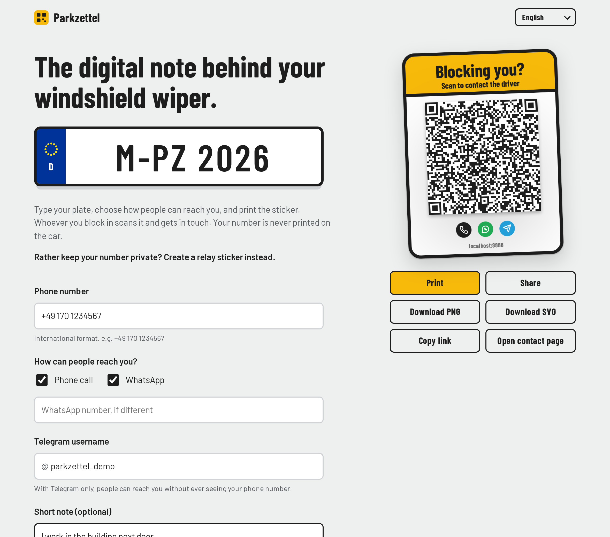
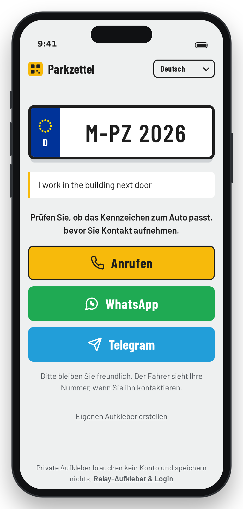
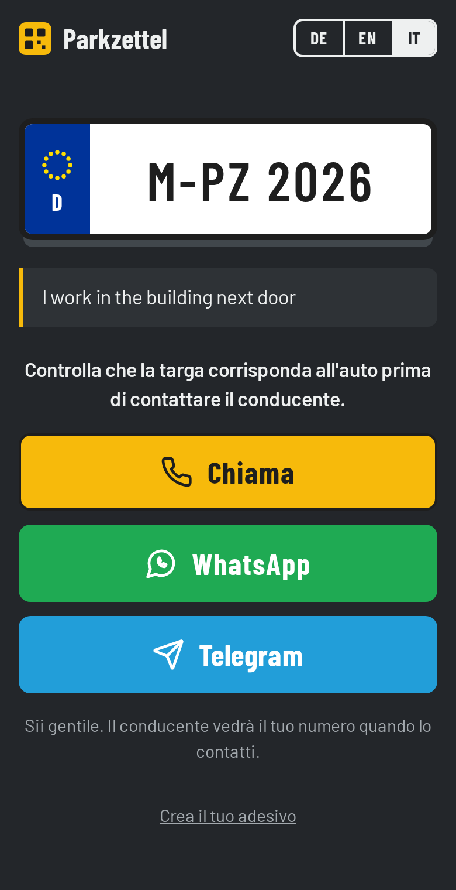
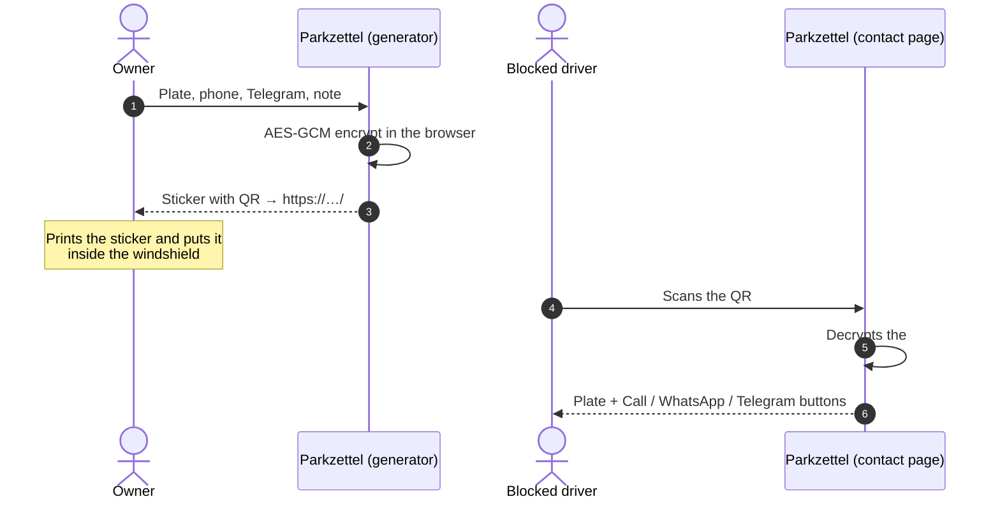
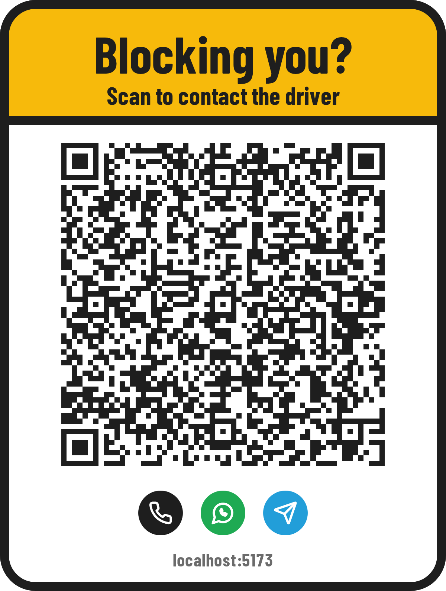

<div align="center">


# Parkzettel

**The digital note behind your windshield wiper.**

A QR sticker for your car. When you block someone in, they scan it and reach you by phone, WhatsApp or Telegram.
Everything runs in the browser, so there is no account to create and no server that stores your number.

[](https://vite.dev)
[](https://www.typescriptlang.org)
[](#privacy)
[](#languages)
[](#)

[Deploy to Netlify](https://app.netlify.com/start/deploy?repository=https://github.com/AYastrebov/Parkzettel) ·
[Run locally](#run-locally) ·
[How it works](#how-it-works)

</div>

<br />

<table>
  <tr>
    <td width="58%"></td>
    <td width="21%"></td>
    <td width="21%"></td>
  </tr>
  <tr>
    <td align="center"><sub>Create your sticker</sub></td>
    <td align="center"><sub>What the scanner sees</sub></td>
    <td align="center"><sub>Same page in Italian, dark mode</sub></td>
  </tr>
</table>

## Features

- The contact page shows your plate in EU style, with its country code, so the scanner knows they found the right driver.
- You choose any mix of call, WhatsApp and Telegram. WhatsApp opens with a message that names the plate, written in the scanner's language.
- Your contact data is AES-GCM encrypted into the link itself and is never stored anywhere.
- The sticker downloads as a 1200 px PNG or as an SVG you can print at any size. It prints the site's domain under the code, so people can see where it leads before they scan.
- The site speaks German, English and Italian. It picks the browser's language, and the sticker text follows whichever one you select.
- The contact page is designed for a phone and supports dark mode.
- The build is about 17 kB of gzipped JavaScript. It makes no external requests, has no tracking, and runs on any static host.

## How it works



The token format is `"1" + base64url(key[16] ‖ iv[12] ‖ ciphertext)`. The leading `1` is a format version, so a future encoding can coexist with stickers that are already printed.

<p align="center">
  
</p>

## Privacy

The site is a set of static files, and all the work happens in the browser. The contact data lives in the part of the URL after `#`, which browsers never send to a server, so hosting logs don't see it. Fonts are bundled, and there are no analytics or CDN requests. The page sets `Referrer-Policy: no-referrer`, and contact pages are marked `noindex`.

> [!IMPORTANT]
> The person who scans the code has to be able to read it, so the decryption key is part of the QR.
> Encryption keeps your data from being readable at a glance in the URL, and it detects damaged links.
> It does not stop anyone who has the link, or a photo of the sticker, from seeing the contact options you chose.
> It also cannot prove who made a sticker: anyone can create one, so the contact page asks scanners to check that the plate matches the car.
> To keep your phone number private, offer Telegram only or use a second number.

> [!TIP]
> If your number changes, create a new sticker. Without a database, there is nothing to update.

## Languages

| | Sticker headline | Contact page |
|---|---|---|
| Deutsch | *Zugeparkt?* | Fahrer kontaktieren von … |
| English | *Blocking you?* | Contact the driver of … |
| Italiano | *Ti blocco?* | Contatta il conducente di … |

All strings live in [`src/i18n.ts`](src/i18n.ts). To add a language, copy the `de` dictionary; TypeScript reports any key you missed.

## Run locally

```bash
npm install
npm run dev       # http://localhost:5173
npm run build     # type-check + production build → dist/
npm run preview   # serve dist/
```

> [!NOTE]
> Web Crypto works only on HTTPS or `localhost`. To test on a phone, serve the dev server over HTTPS
> (for example with `tailscale serve`) and open the generator from that URL, because the QR encodes the address you created it from.

## Deploy

The live site is **https://parkzettel.netlify.app/**. Netlify deploys every push to `main` and builds a preview for each pull request.

To run your own copy, click *Deploy to Netlify* above or import the repo. [`netlify.toml`](netlify.toml) holds the build settings.
Any other static host works too: run `npm run build` and serve `dist/`.

> [!WARNING]
> Choose your final domain before printing stickers, because the full URL is inside every QR code.
> A shorter domain also makes the QR code less dense and easier to scan.

## Project layout

```
src/
├── main.ts        # app shell, language switcher, routing (#token → contact page)
├── generator.ts   # create mode: form, validation, preview, downloads
├── contact.ts     # scan mode: plate + contact buttons
├── codec.ts       # compact payload + AES-GCM seal/open
├── sticker.ts     # self-contained sticker SVG → PNG
├── i18n.ts        # DE / EN / IT strings
├── icons.ts       # call / WhatsApp / Telegram glyphs (Lucide, ISC)
├── plate.ts       # EU plate stars and country codes
└── style.css
```

AI coding agents: see [`AGENTS.md`](AGENTS.md).
