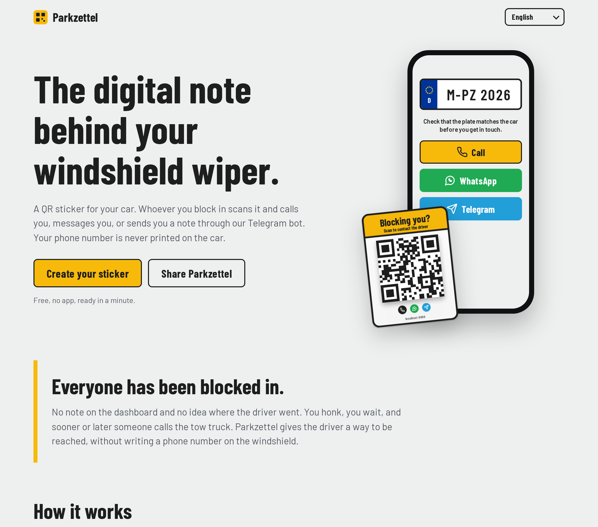
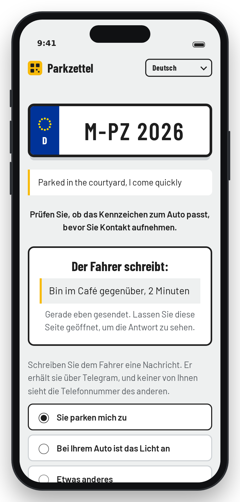
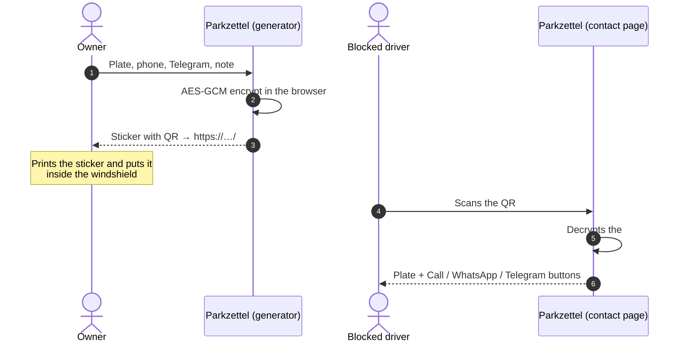
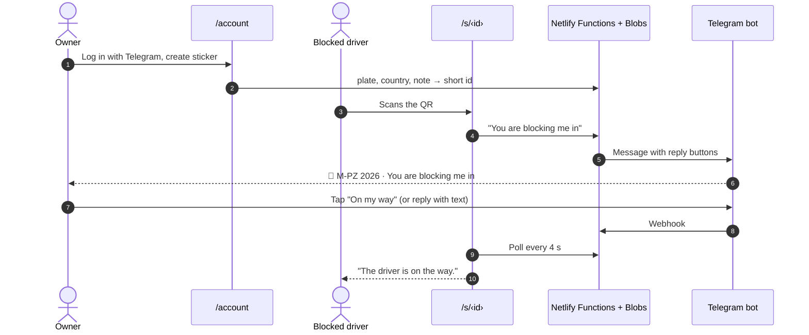
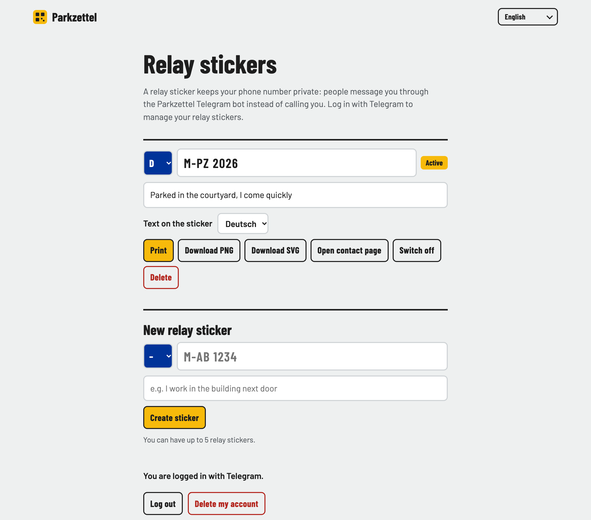

<div align="center">


# Parkzettel

**The digital note behind your windshield wiper.**

A QR sticker for your car. When you block someone in, they scan it and reach you.
A **private sticker** needs no account and stores nothing: the contact data is encrypted into the QR code itself.
A **relay sticker** hides your phone number: messages reach you through a Telegram bot, and you answer with one tap.

[](https://vite.dev)
[](https://www.typescriptlang.org)
[](#privacy)
[](#relay-stickers)
[](#languages)

[Live site](https://parkzettel.fyi/) ·
[Create a sticker](https://parkzettel.fyi/create) ·
[How it works](#how-it-works) ·
[Run locally](#run-locally) ·
[Run your own copy](#run-your-own-copy)

</div>

<br />

<p align="center">
  
</p>

<table>
  <tr>
    <td width="58%"></td>
    <td width="21%"></td>
    <td width="21%"></td>
  </tr>
  <tr>
    <td align="center"><sub>Create your sticker</sub></td>
    <td align="center"><sub>Private sticker: what the scanner sees</sub></td>
    <td align="center"><sub>Relay sticker: the driver has replied</sub></td>
  </tr>
</table>

## Features

- The contact page shows your plate in EU style, with its country code, so the scanner knows they found the right car. It asks them to check the plate before getting in touch.
- Private stickers offer any mix of call, WhatsApp and Telegram. WhatsApp opens with a message that names the plate, written in the scanner's language.
- Relay stickers let scanners send "You are blocking me in", "Your lights are on" or their own text. You get it in Telegram and answer with one tap or your own text; the scanner sees the answer on the page. Neither side sees the other's number.
- "Print" gives you a ready-made A4 sheet with two 8 cm stickers and cut lines. On phones, "Share" opens the share sheet. PNG and SVG downloads are there too. Every sticker prints the site's domain under the code, so people can see where it leads before they scan.
- The whole site speaks German, English and Italian. The pages a scanner sees also come in French, Spanish, Dutch, Polish, Turkish, Ukrainian and Russian. The language follows the browser and can be switched at any time.
- Built for a phone held next to a car: big buttons, dark mode, about 50 kB of gzipped JavaScript with the fonts bundled.
- The landing page at `/` explains the idea and has a "Share Parkzettel" button; shared links show a preview card (Open Graph, `public/og.png`). The generator lives at `/create`.

## How it works

### Private sticker



The token format is `"1" + base64url(key[16] ‖ iv[12] ‖ ciphertext)`. The leading `1` is a format version, so a future encoding can coexist with stickers that are already printed. No server is involved at any point.

### Relay sticker



<p align="center">
  
</p>

## Privacy

**Private stickers** are a set of static files, and all the work happens in the browser. The contact data lives in the part of the URL after `#`, which browsers never send to a server, so hosting logs don't see it. Nothing is stored anywhere.

**Relay stickers** store, in Netlify Blobs: the owner's numeric Telegram ID and language, each sticker's plate, country code and note, and scanner messages for 24 hours. Rate-limit counters use HMACs of the IP address and expire after 10 minutes. Names, usernames, photos and raw IP addresses are never stored. Deleting the account deletes its stickers.

**Third parties.** Fonts are bundled, and the pages scanners see load nothing from third parties. Telegram's login script loads only on the account page. Netlify, the host, sees visitors' IP addresses as any host does, and its [Real User Monitoring](https://docs.netlify.com/manage/monitoring/real-user-monitoring/) sends anonymous performance timings (Web Vitals, browser and platform) to Netlify. It sets no cookies and does not report the page URL, so it never sees a sticker's token. The page sets `Referrer-Policy: no-referrer` and a strict Content Security Policy, and contact pages are marked `noindex`.

> [!IMPORTANT]
> The person who scans a private sticker has to be able to read it, so the decryption key is part of the QR.
> Encryption keeps your data from being readable at a glance in the URL, and it detects damaged links.
> It does not stop anyone who has the link, or a photo of the sticker, from seeing the contact options you chose.
> It also cannot prove who made a sticker: anyone can create one, so the contact page asks scanners to check that the plate matches the car.
> To keep your phone number private, use a relay sticker, offer Telegram only, or use a second number.

> [!TIP]
> If your number changes, create a new private sticker. Relay stickers can be edited, switched off and deleted without reprinting.

## Relay stickers

Private stickers are the default. Relay stickers are an opt-in alternative for owners who want to keep their number private:

- The QR code holds only a short link (`/s/<id>`), so it is far less dense than a private sticker's and uses error correction level H.
- Scanners pick a message ("You are blocking me in", "Your lights are on", or their own text) and send it through [@ParkzettelBot](https://t.me/ParkzettelBot). The owner answers with one tap ("On my way", "In about 10 minutes", "Can't come right now") or by replying to the bot's message with their own text. The scanner sees the answer on the page and can send a follow-up. The bot's message also has a button to switch the sticker off.
- Owners log in at `/account` with Telegram and can change the plate or note, switch a sticker off, or delete it, without reprinting. Up to five stickers per account.
- Abuse limits: 3 messages per scanner per sticker and 20 per sticker every 10 minutes; only the sticker's owner can answer; messages expire after 24 hours.

<p align="center">
  
</p>

The backend is a handful of Netlify Functions (`netlify/functions/`) with Netlify Blobs for storage.

| Endpoint | Auth | Purpose |
|---|---|---|
| `GET /api/auth/telegram` | Telegram signature | Login Widget callback. Keeps only the numeric ID. |
| `GET/POST /api/me` | session | Login status, logout, delete account |
| `GET/POST /api/stickers[/:id]` | session | List, create, update, switch, delete |
| `GET /api/s/:id` | public | Plate, country, note, active flag (never the owner's ID) |
| `POST /api/s/:id/message` | public, rate limited | Send the owner a message via the bot |
| `GET /api/m/:id` | public | The owner's reply, if any |
| `POST /api/telegram` | webhook secret | Bot updates: `/start`, reply buttons, text replies |
| `POST /api/telegram/setup` | production only | Registers the webhook |
| `cleanup` | scheduled hourly | Deletes expired messages and rate-limit counters |

## Languages

Two tiers, because the person scanning a sticker can be anyone, while owners pick a site they can read:

| Tier | Languages | Covers |
|---|---|---|
| Full | Deutsch, English, Italiano | Everything, including the sticker text and the bot's messages to owners |
| Scanner | Français, Español, Nederlands, Polski, Türkçe, Українська, Русский | The pages a scanner sees: contact page, relay page, error page, footer, WhatsApp message. Other pages fall back to English. |

| | Sticker headline | Contact page |
|---|---|---|
| Deutsch | *Zugeparkt?* | Fahrer kontaktieren von … |
| English | *Blocking you?* | Contact the driver of … |
| Italiano | *Ti blocco?* | Contatta il conducente di … |

Site strings live in [`src/i18n.ts`](src/i18n.ts), the texts the bot sends to owners in [`netlify/lib/bot-text.ts`](netlify/lib/bot-text.ts). To add a scanner language, copy the `fr` dictionary; for a full language, copy `de`. TypeScript reports any key you missed. The scanner-tier translations were drafted without a native reviewer, so corrections are welcome.

## Run locally

```bash
npm install
npm run dev       # frontend only: http://localhost:5173
npm run build     # type-check + production build → dist/
npm run preview   # serve dist/
```

With the backend (functions and a local Blobs sandbox):

```bash
TELEGRAM_DRY_RUN=1 SESSION_SECRET=dev TELEGRAM_WEBHOOK_SECRET=dev TELEGRAM_BOT_TOKEN=1:dev \
  npx netlify-cli dev      # http://localhost:8888
```

`TELEGRAM_DRY_RUN=1` logs bot calls instead of sending them. On `localhost` the account page shows a "Dev login" button, because Telegram's Login Widget only works on the domain registered with BotFather.

> [!NOTE]
> Web Crypto works only on HTTPS or `localhost`. To test private stickers on a phone, serve the dev server over HTTPS
> (for example with `tailscale serve`) and open the generator from that URL, because the QR encodes the address you created it from.

## Run your own copy

The live site is **https://parkzettel.fyi/**, deployed by Netlify from `main`.

1. Import the repo into Netlify. [`netlify.toml`](netlify.toml) holds the build settings and security headers.
2. For relay stickers, create a bot with [@BotFather](https://t.me/BotFather), run `/setdomain` with your site's domain, and add three environment variables scoped to **Functions**, marked as secret: `TELEGRAM_BOT_TOKEN`, `TELEGRAM_WEBHOOK_SECRET` (any random string) and `SESSION_SECRET` (another one). Set the bot username in `src/account.ts` and `netlify/lib/telegram.ts`. [`docs/bot-avatar.png`](docs/bot-avatar.png) is the bot's profile picture (`/setuserpic`).
3. After the first deploy, register the webhook once: `curl -X POST https://<your-site>/api/telegram/setup`.

Private stickers work on any static host without steps 2 and 3.

> [!WARNING]
> Choose your final domain before printing stickers, because the full URL is inside every QR code.
> A shorter domain also makes private stickers' QR codes less dense and easier to scan.

## Project layout

```
src/
├── chrome.ts      # shared header, language picker, footer
├── main.ts        # public app entry, routing: /s/<id> → relay page, /#token → contact page,
│                  #   /create → generator, / → landing page
├── landing.ts     # marketing page with live sticker and phone mockup, share button
├── generator.ts   # create mode: form, validation, preview, print/share/downloads
├── contact.ts     # private sticker scan page: plate + contact buttons
├── relay.ts       # relay sticker scan page: send a message, see the reply
├── account.ts     # owner page: Telegram login, relay sticker management
├── codec.ts       # compact payload + AES-GCM seal/open (token format)
├── sticker.ts     # self-contained sticker SVG → PNG
├── share.ts       # print sheet (two 80 mm copies) and Web Share
├── i18n.ts        # full (DE/EN/IT) and scanner-tier dictionaries, language detection
├── icons.ts       # Lucide-derived glyphs (ISC)
├── plate.ts       # EU plate stars and country codes
└── style.css
netlify/
├── functions/     # login, session, stickers, relay messages, bot webhook, hourly cleanup
└── lib/           # crypto, session cookie, Blobs stores, validation, rate limit, Telegram API, bot texts
scripts/
├── screenshots.mjs  # regenerates docs/*.png (npm run screenshots; needs netlify dev)
├── frame.mjs        # phone frame for screenshots
└── og-image.mjs     # renders public/og.png, the link-preview card (npm run og-image)
```

AI coding agents: see [`AGENTS.md`](AGENTS.md).
